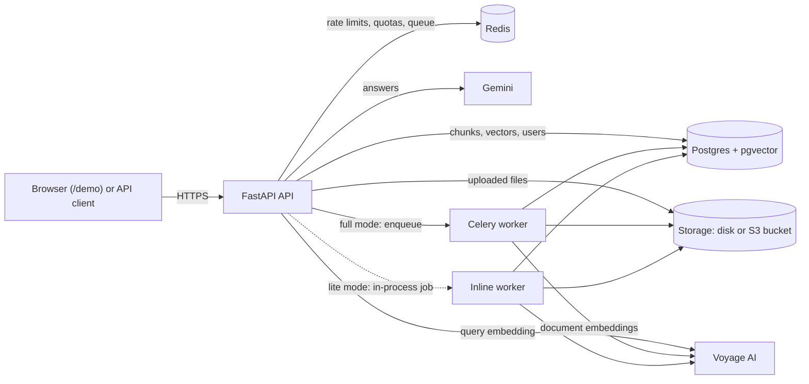

# DocuMind

[](https://github.com/musharraf58/DocuMind/actions/workflows/ci.yml)

DocuMind is a question-answering API over your own documents: upload PDFs,
Word files, Markdown or text, and ask questions in plain language. Answers
are written by an LLM only from passages retrieved from your documents, and
every citation is checked against the sources the model was actually given.
It runs in full mode with Docker Compose, or entirely on free tiers in a
512 MB "lite mode" with no background worker.

**Live demo:**https://documind-rdn9.onrender.com **Demo login:** demo@example.com
Password:
ZHtcCyHf1iVzzooIbbp4mg

## Results

Measured, not estimated; each number links to where it was measured.
Retrieval on the evaluation set (17 answerable and 4 unanswerable questions
over 7 self-written documents) finds the right passage first 76% of the
time, in the top 3 94% and in the top 5 100% (MRR 0.858), and the measured
relevance threshold turns away no answerable question while rejecting 1 of
the 4 unanswerable ones ([EVALUATION.md](docs/EVALUATION.md)). The set is
small, so these are signs, not guarantees. Under a 512 MB limit the API
peaked at 262 MB with a 480-page document, 5 questions and 5 downloads at
once, and a question costs 7 Redis commands, so the free Redis tier carries
the app ([HARDENING.md](docs/HARDENING.md), sections 4 and 5). The suite has
1,177 Python tests, run in CI against real Postgres and Redis, plus 14
JavaScript tests for the demo page ([CI.md](docs/CI.md)).

## Architecture



Full mode runs a separate Celery worker; lite mode runs the same job code
inside the API process. Both modes, the ingestion and question sequences and
the data model are drawn in [ARCHITECTURE.md](docs/ARCHITECTURE.md).

## Tech stack

| Layer | Choice | Why |
| --- | --- | --- |
| API | Python 3.12, FastAPI (async) | Typed request models, async I/O for slow provider calls |
| Database | PostgreSQL 16 + pgvector, SQLAlchemy 2.0 async, Alembic | Vectors, full-text search and data in one transactional store |
| Search | HNSW vector index + Postgres full-text search, fused with RRF | Meaning and exact terms ([EVALUATION.md](docs/EVALUATION.md)) |
| Embeddings | Voyage AI (`voyage-4-lite`, 1024 dimensions) | Free tier; retrieval measured in [EVALUATION.md](docs/EVALUATION.md) |
| Answers | Google Gemini (`gemini-3.5-flash-lite`) | Free tier |
| Jobs | Celery + Redis (full mode) or an in-process worker (lite mode) | Same job code; lite mode needs no paid worker |
| Limits | Redis, sliding windows in Lua scripts | Atomic across processes |
| Files | Local disk or any S3-compatible bucket (boto3) | R2 or B2 on the free tier |
| Extraction | pypdf, python-docx, tiktoken | Pages and sections kept for citations |
| Auth | argon2 password hashing, JWT with a per-user token version | Password change revokes every token |
| Demo page | Plain HTML, CSS and JavaScript modules, no build step | Nothing third-party to load or trust |
| Quality | pytest, ruff, GitHub Actions, pip-audit, Dependabot | [CI.md](docs/CI.md) |

## Quick start (full mode, Docker Compose)

Needs Docker with Compose. Fake providers by default: no API keys, no
network, but the "answers" are scripted and search results are random.

```bash
cp .env.example .env
# In .env: set SECRET_KEY (python -c "import secrets; print(secrets.token_urlsafe(32))")
# and REGISTRATION_MODE=open. For real answers: EMBEDDING_PROVIDER=voyage,
# EMBEDDING_API_KEY, LLM_PROVIDER=gemini, LLM_API_KEY.
docker compose up --build -d          # API, worker, Postgres, Redis; migrations run on start
curl localhost:8000/health/ready      # database, Redis and worker "ok"
```

Then register, upload and ask:

```bash
curl -X POST localhost:8000/auth/register -H 'Content-Type: application/json' \
  -d '{"email":"me@example.com","password":"correct-horse-battery"}'
TOKEN=$(curl -s -X POST localhost:8000/auth/login \
  -d 'username=me@example.com&password=correct-horse-battery' \
  | python3 -c 'import sys,json; print(json.load(sys.stdin)["access_token"])')
COLLECTION=$(curl -s -X POST localhost:8000/collections -H "Authorization: Bearer $TOKEN" \
  -H 'Content-Type: application/json' -d '{"name":"My docs"}' \
  | python3 -c 'import sys,json; print(json.load(sys.stdin)["id"])')
curl -X POST localhost:8000/collections/$COLLECTION/documents \
  -H "Authorization: Bearer $TOKEN" -F "file=@notes.md"
curl -N -X POST localhost:8000/collections/$COLLECTION/ask/stream \
  -H "Authorization: Bearer $TOKEN" -H 'Content-Type: application/json' \
  -d '{"question":"What do my notes say about testing?"}'
```

Interactive API docs: <http://localhost:8000/docs>. Every endpoint is in
[API.md](docs/API.md); running without Docker, lite mode and deployment are
in [OPERATIONS.md](docs/OPERATIONS.md).

## How it works

- **Ingestion.** An upload is stored and saved as `pending`, and the API
  answers `202` at once. A job claims the document, extracts the text (PDF
  pages, DOCX and Markdown sections), splits it into chunks of up to 500
  tokens, embeds them within the provider's rate limits, and stores chunks
  and vectors in one transaction. A sweeper re-queues anything stuck, so a
  crashed job never leaves a document hanging.
- **Hybrid retrieval.** A question is embedded and searched two ways: by
  meaning (pgvector) and by keywords (Postgres full-text search). Reciprocal
  Rank Fusion merges the two lists by rank. Keywords rescue rare exact terms
  like error codes, which embeddings blur.
- **A relevance gate.** If no retrieved chunk is close enough (a distance
  threshold chosen by measurement), the answer is "not found" and the LLM is
  never called.
- **Grounded answers with validated citations.** The model sees only
  numbered source passages, inside a block it is told to treat as data.
  Afterwards every `[n]` is checked against the sources it was given;
  invalid ones are removed, and an answer that cites nothing valid is marked
  `grounded: false`.
- **Streaming.** `POST .../ask/stream` sends server-sent events: `meta`,
  then `token` events as text is generated, then `done` with the final,
  validated answer (or `error`). Follow-up questions are rewritten into
  standalone ones before searching.

Details: [ARCHITECTURE.md](docs/ARCHITECTURE.md).

## Security and limits

- Per-user data isolation: every query filters by owner; someone else's
  collection answers 404, the same as a missing one.
- Rate limits per endpoint class (Redis sliding windows), progressive delays
  after failed logins, per-email login limits, invite-only registration.
- Daily quotas per user (questions, uploads, embedding tokens) and a global
  daily LLM budget that protects the shared free-tier quota.
- Upload caps (size, count, total storage), DOCX zip-bomb guards, and a
  content check on every file type.
- Argon2 passwords; a password change revokes every older token.
- Security headers and a strict Content-Security-Policy, CORS closed by
  default, request body limits, one error shape that never echoes input.
- Production refuses to start on a weak configuration (weak key, docs on,
  rate limits off, fake providers).
- Behind Render's proxy no `X-Forwarded-For` entry is trusted, so no client
  can fake its address; measured on the live service.

Every limit, its default and the reason: [SECURITY.md](docs/SECURITY.md).

## Known limitations

- **Cold start.** The free instance sleeps after 15 idle minutes, and the
  first request then waits about a minute (measured: TODO(me) seconds).
  That includes opening `/demo`, which is served by the same instance.
- **Shared demo data.** Everyone using the demo account sees the same
  collections and conversations, and shares its daily quotas.
- **Gemini's free tier may use inputs** (questions and document excerpts) to
  improve Google's products. Don't put anything private into the demo.
- **Voyage's free tier allows 3 requests a minute**, so a large document
  takes minutes to an hour to embed.
- **Retrieval can't detect every unanswerable question**: at the chosen
  threshold the gate rejected 1 of 4 unanswerable test questions
  ([EVALUATION.md](docs/EVALUATION.md)). The rest go to the model, whose
  answers must still cite sources.
- **No OCR**: scanned PDFs fail with "No readable text found".
- **Redis on the free tier**: the command budget is calculated in
  [HARDENING.md](docs/HARDENING.md); observed usage on Upstash: TODO(me).

## What I would do next

- Serve the demo page from a free static host, so it loads while the API
  wakes up.
- A larger evaluation set from real documents, and an evaluation of answer
  quality (faithfulness), not only retrieval.
- Reranking the fused candidates, and a better signal than distance for
  "the answer isn't in the documents".
- OCR for scanned PDFs.
- Per-tenant isolation in the database (row-level security) as a second
  line behind the owner filters.
- Paid-tier settings: billing on Gemini (no training on inputs), higher
  Voyage limits, a separate worker and several API instances.

## Documentation

| File | What's in it |
| --- | --- |
| [ARCHITECTURE.md](docs/ARCHITECTURE.md) | Components, ingestion, retrieval, answers, data model, with diagrams |
| [API.md](docs/API.md) | Every endpoint, with examples and errors |
| [SECURITY.md](docs/SECURITY.md) | Every limit, quota and protection, with defaults and reasons |
| [OPERATIONS.md](docs/OPERATIONS.md) | Full mode, lite mode, deploying to Render, every environment variable, tests |
| [LITE_LOCAL.md](docs/LITE_LOCAL.md) | Running lite mode locally, like production |
| [EVALUATION.md](docs/EVALUATION.md) | Retrieval measurements and how the defaults were chosen |
| [HARDENING.md](docs/HARDENING.md) | Indexes, connection pool, dependency audit, Redis budget, memory, proxy finding |
| [CI.md](docs/CI.md) | The CI pipeline and branch protection |
