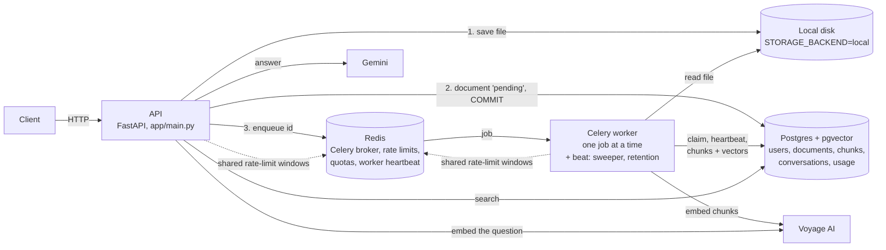
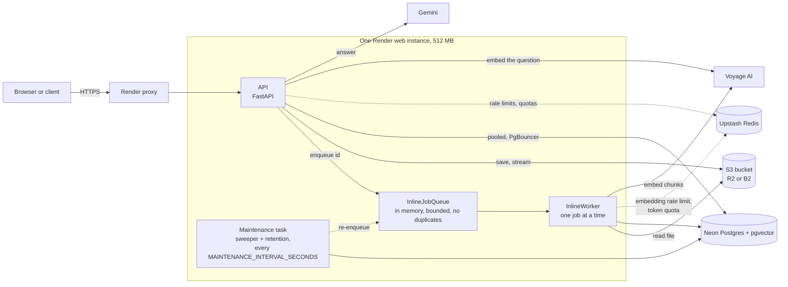
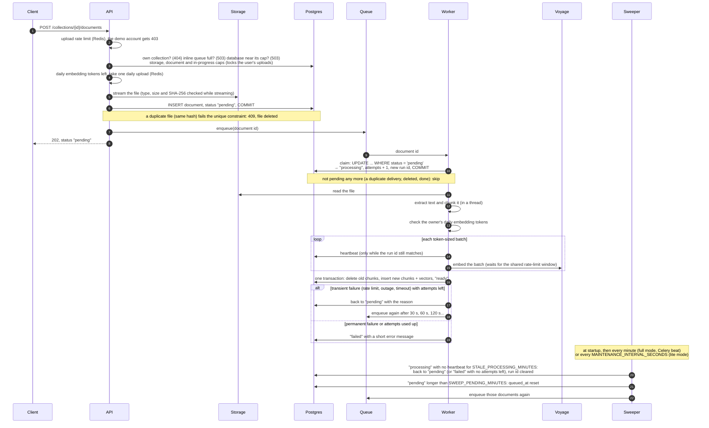
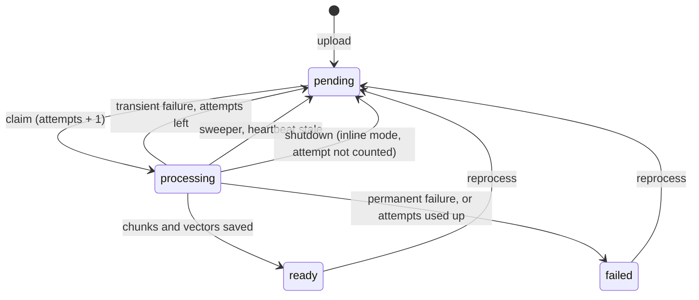
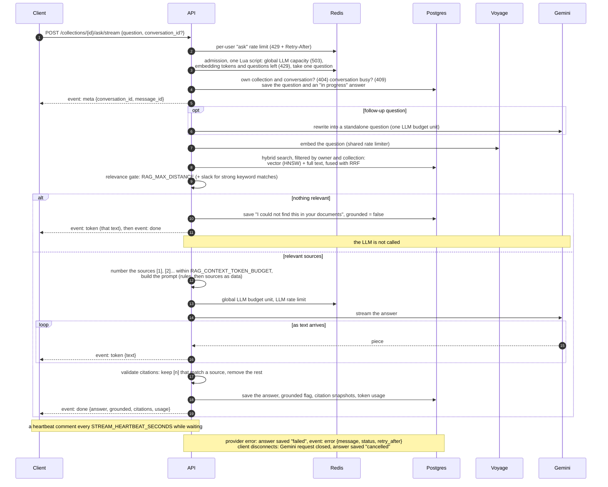
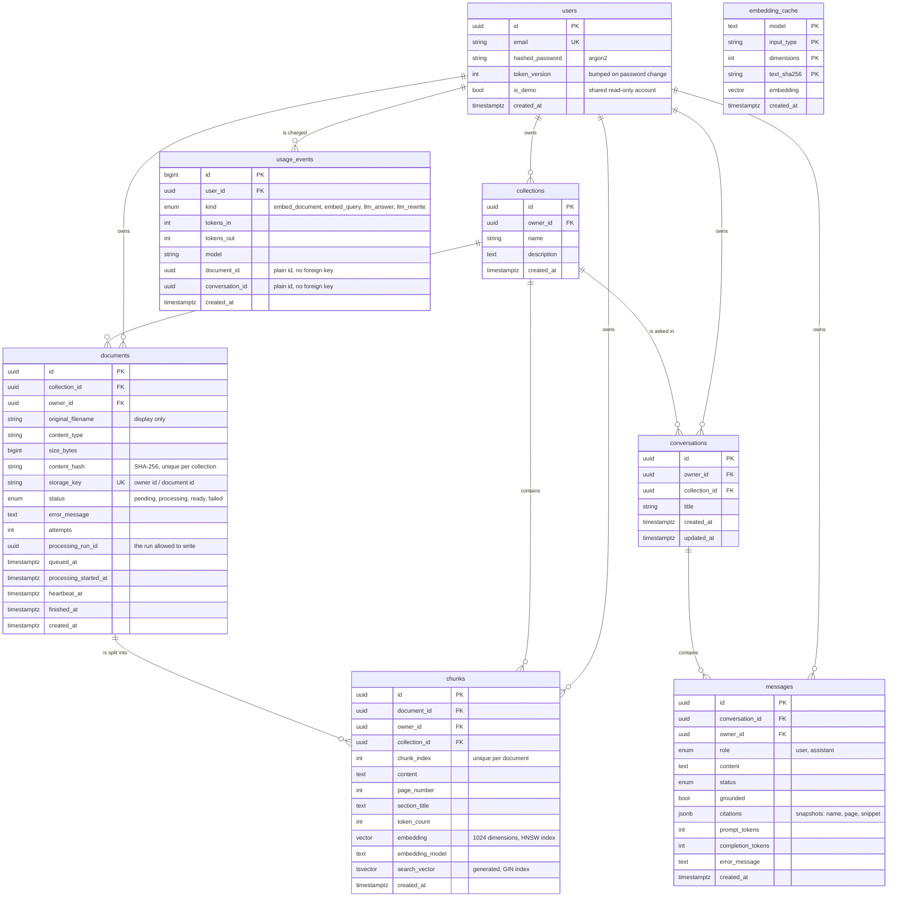

# Architecture

How DocuMind is put together, from the code. The endpoints are in
[API.md](API.md), every limit in [SECURITY.md](SECURITY.md), running and
deploying in [OPERATIONS.md](OPERATIONS.md).

## Components

DocuMind runs in two modes with the same code. They differ only in where
document jobs run and what holds the files.

### Full mode (Docker Compose)



- **API** (`app/main.py`): accepts uploads, saves the file and the document as `pending`,
  commits, and only then puts a job on the queue. It answers `202` at once; clients poll
  `GET /documents/{id}` for the status.
- **Redis**: the job queue (Celery broker) and the shared embedding rate-limit window, so
  the API's searches and the worker's ingestion never exceed the account's limits together.
- **Worker** (`app/workers/`): one Celery process, one job at a time. A job claims the
  document (`pending` → `processing`), extracts, chunks and embeds it, refreshing a heartbeat
  as it goes, and saves the chunks in one transaction (`ready`). Transient failures are
  retried with a growing delay; permanent ones fail at once.
- **Sweeper** (runs in the worker every minute, and once at startup): re-enqueues documents
  pending too long (say the upload happened while Redis was down) and resets documents whose
  worker died mid-job (stale heartbeat), so nothing is ever stuck.
- **Gemini** (`app/services/llm/`) writes answers to questions from the retrieved chunks,
  called by the API with its own Redis rate limit (see [Asking questions](API.md#asking-questions)).
- **Postgres** holds the truth: the queue may lose or repeat a message; the database state
  decides what actually happens.


### Lite mode (free tier, `INGESTION_MODE=inline`)



- **No Celery worker.** `app/services/inline_worker.py`: uploads go to an
  in-memory queue (`INLINE_QUEUE_CAPACITY`, 20) and one background task runs
  them through `jobs.process_document`, the same function the Celery task
  calls. The claim, heartbeat, retries and failure handling are shared.
- **The queue may forget; Postgres doesn't.** A restart empties the queue.
  The maintenance task (`app/services/background.py`) runs the same sweeper
  at startup and every `MAINTENANCE_INTERVAL_SECONDS`, so documents left
  `pending` or stuck `processing` are found again in the database.
- **Redis only counts.** No broker and no worker heartbeat: an idle app
  sends Upstash no commands ([HARDENING.md](HARDENING.md), section 4).
- **Files in a bucket**, because the instance's disk is wiped on every
  restart (`app/services/s3_storage.py`).

## Ingestion: extraction and chunking

Processing turns an uploaded document into **chunks**: pieces of its text of at most
`CHUNK_TOKENS` tokens (default 500), each sharing about `CHUNK_OVERLAP_TOKENS` (default 60)
with the previous one. Each chunk is then **embedded** (turned into a vector) so it can be
searched by meaning (see [Embeddings](#embeddings) below).

### The ingestion sequence

Upload, then everything after the `202` happens in the background. The
worker is the Celery worker in full mode and the inline worker in lite mode;
both run `jobs.process_document` (`app/services/jobs.py`).



The document's states:



How it works:

1. The worker claims the document: `pending` → `processing`, `attempts` + 1. Only a
   `pending` document can be claimed, so a job delivered twice runs once.
2. Text is extracted in a worker thread: PDF page by page (chunks get a `page_number`),
   DOCX paragraphs and tables (headings become `section_title`), Markdown sections
   (`#` headings become `section_title`), plain text as is. The text is then cleaned
   (whitespace normalized, null characters removed, words hyphenated across lines rejoined).
3. The text is split by paragraph, then line, sentence and word until pieces fit, and the
   pieces are packed into chunks. A chunk never spans two pages or sections.
4. All chunks are embedded by the embedding provider, in token-sized batches that respect
   its rate limits (see [Outbound limits](SECURITY.md#outbound-limits-the-embedding-provider)). This can take minutes, and no database transaction
   is open meanwhile.
5. In a single transaction, the old chunks are deleted, the new ones inserted with their
   vectors, and the document marked `ready`.

If anything fails, the previous chunks (and their vectors) are kept, and:

- **Permanent** problems (scanned or corrupt file, unsupported type, over a limit, invalid
  API key): `failed` at once, with a short `error_message`. Retrying wouldn't change it.
- **Transient** problems (rate limit, provider outage, timeout, database or Redis blip):
  back to `pending` with `error_message` saying which attempt failed, and retried after
  30 s, 60 s, 120 s... Once `attempts` reaches `MAX_JOB_ATTEMPTS` the document is `failed`.

You can reprocess `ready` and `failed` documents at any time. A document deleted while it is
being processed is left alone: the job notices at its next step, stops, and writes nothing.

Background job settings:

| Setting | Default | Meaning |
|---|---|---|
| `MAX_JOB_ATTEMPTS` | 4 | Tries per document for transient failures |
| `JOB_RETRY_BASE_SECONDS` | 30 | First retry delay; doubles each time |
| `JOB_TIMEOUT_MINUTES` | 120 | Longest one job may run (a very large document takes ~1-2 hours at 10,000 tokens/minute) |
| `SWEEP_PENDING_MINUTES` | 3 | The sweeper re-enqueues documents pending longer than this |
| `STALE_PROCESSING_MINUTES` | 10 | ...and resets processing documents with no heartbeat for this long |

Deleting a document or collection deletes its chunks too.

Settings (see `.env.example`):

| Setting | Default | Meaning |
|---|---|---|
| `CHUNK_TOKENS` | 500 | Max tokens per chunk (tiktoken `cl100k_base`, an approximation) |
| `CHUNK_OVERLAP_TOKENS` | 60 | Tokens repeated from the previous chunk; must be under half of `CHUNK_TOKENS` |
| `MAX_EXTRACT_PAGES` | 500 | PDFs with more pages fail |
| `MAX_EXTRACTED_CHARS` | 2000000 | Documents with more text fail |
| `MIN_EXTRACTED_CHARS` | 50 | Documents with less text fail (typically scanned PDFs) |
| `MAX_DOCX_UNCOMPRESSED_MB` | 100 | Zip-bomb guard: DOCX files that would expand past this fail |
| `MAX_DOCX_ENTRIES` | 1000 | Zip-bomb guard: DOCX files with more internal parts fail |

Known limitations:

- No OCR: scanned PDFs fail with "No readable text found".
- PDFs that need a password, or use AES encryption, fail.
- DOCX headers, footers, footnotes and comments are not extracted.
- Each job has a time limit (`JOB_TIMEOUT_MINUTES`), but extraction itself runs in a thread,
  which can't be interrupted: a pathological file is bounded by the size limits and, as a
  last resort, by the worker's hard time limit.
- tiktoken downloads its vocabulary (a few MB) the first time it runs locally. The Docker
  image includes it at build time.

### Long jobs, heartbeats and one run per document

Long runs happen in the worker, not in an HTTP request: the worker refreshes the document's
`heartbeat_at` before every embedding request, so the sweeper can tell a slow job from a
dead one.

**One run per document.** `reprocess` returns `409` while a document is pending or being
processed, and the worker only claims `pending` documents. A run counts as abandoned only if
its heartbeat is older than `STALE_PROCESSING_MINUTES`; the sweeper then resets the document
for a new run. Each claim carries a run id, and every write a run makes needs that id to
still be on the document, so a run that was replaced stops before its next request to the
provider and never writes chunks or marks the document failed.

## Embeddings

Each chunk's vector is stored in `chunks.embedding` (pgvector, 1024 dimensions) together
with `chunks.embedding_model`, the model that made it. An HNSW index (`vector_cosine_ops`)
makes nearest-neighbour search fast.

Choose the provider with `EMBEDDING_PROVIDER`:

- `fake`: deterministic vectors from a hash of the text, with no network and no key. It's
  good for local development and is what the tests use. The vectors carry **no meaning**,
  so search results are effectively random. They're stored under the model name
  `fake-sha256`, so they're never searched together with real vectors.
- `voyage` (the default): [Voyage AI](https://docs.voyageai.com/docs/embeddings). Set
  `EMBEDDING_API_KEY`. Without a key, processing fails with "Embedding API key is not
  configured".

| Setting | Default | Meaning |
|---|---|---|
| `EMBEDDING_PROVIDER` | `voyage` | `voyage` or `fake` |
| `EMBEDDING_MODEL` | `voyage-4-lite` | Model name sent to the provider |
| `EMBEDDING_DIMENSIONS` | 1024 | Vector size. Must match the database column (see below) |
| `EMBEDDING_API_KEY` | (empty) | Provider API key. Never logged or shown in errors |
| `EMBEDDING_BATCH_SIZE` | 64 | Most texts per request. The token budget below usually ends a batch sooner |
| `EMBEDDING_TIMEOUT_SECONDS` | 30 | Per-request timeout |
| `EMBEDDING_TPM_LIMIT` | 10000 | Your account's tokens per minute |
| `EMBEDDING_RPM_LIMIT` | 3 | Your account's requests per minute |
| `EMBEDDING_RATE_SAFETY` | 0.5 | Fraction of the token limit we plan to use (our tiktoken count can be well below the provider's) |
| `EMBEDDING_MAX_RETRIES` | 6 | Retries per batch on rate limits (429), server errors (5xx) and timeouts |
| `EMBEDDING_RETRY_BASE_SECONDS` | 2 | First retry wait; doubles each time |
| `EMBEDDING_RETRY_MAX_SECONDS` | 60 | Longest backoff wait |
| `EMBEDDING_MIN_RETRY_WAIT_SECONDS` | 60 / RPM limit | Shortest wait after a 429 (20 s at 3 requests per minute) |
| `EMBEDDING_QUERY_MAX_WAIT_SECONDS` | 20 | Longest a search waits for embedding capacity |
| `EMBEDDING_INGEST_RPM_SHARE` | 0.67 | Share of requests per minute background ingestion may use (2 of 3); the rest is kept for searches |

A bad key or invalid input fails at once without retrying.

**Changing the model or dimensions** is a migration, not just a setting. The column
holds vectors of exactly one size, and vectors from different models can't be compared.
See the comment in `alembic/versions/0005_chunk_embeddings.py` for the steps.

## Hybrid retrieval

Embeddings capture meaning but blur rare exact terms: an error code like `ERR-4471` or a
part number can sit far from the chunk that contains it. Keyword search is the opposite.
With `RAG_SEARCH_MODE=hybrid` (the default) both run:

- **vector**: the `HYBRID_CANDIDATES` chunks closest in meaning;
- **keyword**: Postgres full-text search (`websearch_to_tsquery`, ranked by
  `ts_rank_cd`) over a generated `tsvector` column with a GIN index (migration 0009),
  so the column is recomputed by Postgres whenever a chunk is written and can't fall out of
  sync on re-processing;
- **Reciprocal Rank Fusion** merges the two lists: each chunk scores Σ 1 / (`RRF_K` +
  rank) over the lists it appears in. Only ranks are used, never the raw scores, which
  are on incomparable scales (a cosine distance and a `ts_rank_cd` value).

Every candidate gets its vector distance, keyword-only hits included, because the
relevance gate needs it.

| Setting | Default | Meaning |
|---|---|---|
| `RAG_SEARCH_MODE` | `hybrid` | `hybrid` or `vector` |
| `HYBRID_CANDIDATES` | 20 | Candidates from each list before fusion |
| `RRF_K` | 60 | The RRF constant; larger flattens the difference between ranks |
| `RAG_KEYWORD_MATCH` | `strict` | `strict`: a keyword hit needs every term; `loose`: any term |
| `TEXT_SEARCH_CONFIG` | `english` | Stemming and stop words. The index uses `english`; other values work, unindexed |
| `RAG_KEYWORD_GATE_SLACK` | 0.10 | Extra distance allowed for a strong keyword match (0 = off) |

The defaults were chosen by measurement: see [EVALUATION.md](EVALUATION.md).

## How a question flows through the system

### The ask/stream sequence

`POST /collections/{id}/ask/stream` (`app/api/ask.py`,
`app/services/ask_stream.py`, `app/services/answering.py`). `/ask` runs the
same steps and returns the result as one JSON response.



```
question
  │ 1. validate: empty, or longer than ASK_MAX_QUESTION_CHARS → 422 (nothing embedded)
  │ 2. ownership: not your collection → 404
  ▼
retrieval (app/services/retrieval.py)
  │ 3. embed the question (Voyage, through the shared rate limiter)
  │ 4. search (owner + collection filters inside the SQL). Hybrid (the default):
  │      the HYBRID_CANDIDATES nearest chunks by meaning and the best keyword matches,
  │      merged by Reciprocal Rank Fusion, top RAG_TOP_K. Vector: the RAG_TOP_K nearest.
  │ 5. relevance gate (relevance.py): keep chunks within RAG_MAX_DISTANCE; in hybrid
  │      mode, a strong keyword match within RAG_MAX_DISTANCE + RAG_KEYWORD_GATE_SLACK
  │      nothing left → "I could not find this in your documents", grounded=false,
  │                     and the LLM is NOT called
  ▼
context + prompt (context.py, prompts.py)
  │ 6. number the chunks [1], [2], ... best first, until RAG_CONTEXT_TOKEN_BUDGET
  │ 7. system message = rules only; user message = <sources>...</sources> + <question>
  ▼
LLM (app/services/llm/, Gemini)
  │ 8. generate (Redis rate limit LLM_RPM_LIMIT/min, timeout, retries for transient errors)
  ▼
citations (citations.py)
  │ 9. keep [n] that match a supplied source, remove the others; none valid → grounded=false
  ▼
response {answer, grounded, citations, usage}; one log line with counts and token usage
(never the question or document text)
```

**Why skip the LLM when nothing is relevant?** Asked to answer from nothing, a model
guesses, and a guess presented as an answer is worse than "I don't know". Skipping it also
costs nothing and spends none of the daily quota.

**The relevance threshold was measured, not guessed.** `RAG_MAX_DISTANCE=0.70` (with
`RAG_KEYWORD_GATE_SLACK=0.10` in hybrid mode) comes from sweeping thresholds over the
evaluation set ([EVALUATION.md](EVALUATION.md)). Distances depend on the
embedding model and on your documents: after changing either, run `python -m eval.sweep`
again. Use `/search` to see the distances your questions actually get.

## Conversations and follow-up questions

```
first question ──► new conversation (title = the question, ~60 chars; no LLM call)
                   question saved, then answer saved (complete / failed / cancelled)
follow-up      ──► 1. one short LLM call rewrites it into a standalone question, using the
                      last few turns ("And for damaged items?" → "What is the refund policy
                      for damaged items?"); on any failure the original question is used
                   2. the REWRITTEN question is embedded and searched (one Voyage request)
                   3. the answer prompt gets your own question, the last RAG_HISTORY_MAX_TURNS
                      turns (within RAG_HISTORY_TOKEN_BUDGET, newest kept first) in their own
                      <history> block, and this question's sources; old sources are never
                      carried over
```

A follow-up therefore costs two Gemini requests (rewrite + answer); keep that in mind on
the free tier. Only one answer can be written at a time per conversation; a second
request gets `409`. (If a server dies mid-answer, the conversation frees itself after 5
minutes.)

Citations are saved as **snapshots** (document name, page, section, snippet, distance)
rather than links to chunks: re-processing a document replaces its chunks, and old answers
must still show what they cited.

| Setting | Default | Meaning |
|---|---|---|
| `RAG_HISTORY_MAX_TURNS` | 6 | Earlier turns included in the prompt |
| `RAG_HISTORY_TOKEN_BUDGET` | 1000 | ...within this many tokens (newest kept first) |
| `RAG_REWRITE_TIMEOUT_SECONDS` | 10 | After this, a follow-up is searched as asked |
| `STREAM_HEARTBEAT_SECONDS` | 15 | Heartbeat interval while a stream is waiting |

Logs contain ids, counts and token usage only, never question or answer text.

## The answer model (Gemini)

Set `LLM_PROVIDER=gemini` and `LLM_API_KEY` (from Google AI Studio). Settings:

| Setting | Default | Meaning |
|---|---|---|
| `LLM_PROVIDER` | `gemini` | `gemini`, or `fake` for scripted answers without network |
| `LLM_MODEL` | `gemini-3.5-flash-lite` | Stable, available on the free tier |
| `LLM_API_KEY` | (empty) | Sent in the `x-goog-api-key` header; never logged |
| `LLM_MAX_OUTPUT_TOKENS` | 600 | Answer length limit, including the model's thinking tokens |
| `LLM_TIMEOUT_SECONDS` | 30 | Per request |
| `LLM_RPM_LIMIT` | 10 | Requests per minute (shared through Redis) |
| `LLM_TEMPERATURE` | 1.0 | Google recommends 1.0 for Gemini 3 models; lower can cause looping |
| `RAG_TOP_K` | 8 | Chunks retrieved per question |
| `RAG_MAX_DISTANCE` | 0.70 | Relevance cut-off, measured (see [EVALUATION.md](EVALUATION.md)) |
| `RAG_CONTEXT_TOKEN_BUDGET` | 3000 | Source text per question (approximate tokens) |
| `ASK_MAX_QUESTION_CHARS` | 1000 | Longest question accepted |

**Free-tier limits** are no longer published by Google; see your project's page in AI
Studio. An independent measurement found 15 requests per minute and 500 per day for this
model, so `LLM_RPM_LIMIT` defaults to 10. Daily quotas reset at midnight Pacific time.

## Data model

From `app/models/`. Every table that holds user data carries `owner_id`,
and every query filters on it: another user's rows answer 404, the same as
missing ones. Deleting a user, collection, document or conversation removes
everything under it (`ON DELETE CASCADE`).



`embedding_cache` belongs to no user: it maps (model, input type,
dimensions, SHA-256 of the text) to a vector, so the evaluation and the demo
seed never pay twice for the same text. Usage events keep plain ids, not
foreign keys, so the history survives deleting a document or conversation.
